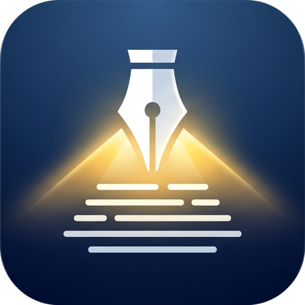

<p align="center">
  
</p>

# InkBeacon

A beacon of light in a “content” world where reading is hard-to-navigate.

A space for studying your own texts: read chapter by chapter, highlight
sentences, build a Mermaid diagram for each chapter and track the progress of
every course. Study state syncs to a private store, protected by a personal
key.

Built with Next.js, Tailwind and Vercel Blob.

## How it works

- **Courses and books** are managed from the **Library** page (`/library`):
  add a book, edit titles and courses, move or delete books. The list is
  stored with everything else (`studio/registry.json`); `lib/courses.ts` only
  fills it the first time.
- **Books** don't live in the repository. The library page converts an EPUB
  or a single-file HTML export in your browser and uploads it to your
  storage: a folder on your server, a private Vercel Blob store, or an
  S3-compatible bucket. The app shows a book only after you've entered the
  key.
- **Your study** (highlights, diagrams, progress) is saved to the same store,
  in `studio/state.json`.
- **`GET /api/progress`** returns the percentages per course, with
  `Authorization: Bearer <STUDIO_ACCESS_KEY>`. It's there to show them
  elsewhere (on a display, for example).

## Diagrams

Each chapter has a Mermaid diagram next to the text. Click a highlight to
**add it to the diagram** as a node (or remove it), and download a diagram
as **SVG or PNG** from the panel's download button. Diagrams can be switched
off on the Library page: everywhere, per course, or per book. Switching them
off hides the panel and keeps what you've drawn.

## Getting started

[](<https://vercel.com/new/clone?repository-url=https%3A%2F%2Fgithub.com%2Fdpakkia%2Finkbeacon&project-name=inkbeacon&repository-name=inkbeacon&env=STUDIO_ACCESS_KEY&envDescription=A%20long%20random%20key%20that%20unlocks%20your%20library%20(e.g.%20openssl%20rand%20-base64%2036)&envLink=https%3A%2F%2Fgithub.com%2Fdpakkia%2Finkbeacon%2Fblob%2Fmain%2FINSTALL.md%23environment-variables&stores=%5B%7B%22type%22%3A%22blob%22%2C%22access%22%3A%22private%22%7D%5D>)

Or run it with Docker, on Netlify, or on your own server: **[INSTALL.md](INSTALL.md)**
covers all of them.

For development you need Node.js 22.13 or later:

```bash
npm install
cp .env.example .env.local   # set STUDIO_ACCESS_KEY, and STORAGE_DIR=./data
npm run dev
```

## Adding a book

Open **Library** (linked from the home page), enter the key, choose an EPUB
or a single-file HTML export (Calibre style: the `.html` alone, or a `.zip` of
its folder to keep the images), check the title, author and course, and press
**Convert and upload**. Chapter and part headings are recognised in English
("Chapter 3", "Part II") and Italian ("Capitolo 3", "Parte II").

Deleting a book from the library removes its text, images, highlights,
diagrams and progress, after you type its id to confirm.

### From the command line

For bulk imports, the same conversion runs in Python, into `data-private/`
(which git ignores), and a script uploads the result to a running server
(`INKBEACON_URL`, default `http://localhost:3000`; it logs in with
`STUDIO_ACCESS_KEY`):

```bash
python3 scripts/import-epub.py book.epub --id my-book \
    --title "Title" --author "Author"
python3 scripts/import-single-html.py folder/ --id my-book \
    --title "Title" --author "Author"

node --env-file=.env.local scripts/upload-book.mjs my-book --course example-course
```

`--pages 240` tracks progress in pages instead of chapters; `--replace`
re-uploads the text of a book that's already in the library; `--epub
book.epub` attaches the original EPUB (KOReader).

The three demo books in `examples/books/` match the example courses; to load
them into a new server:

```bash
mkdir -p data-private/books
cp examples/books/*.json data-private/books/
for id in example study-notes slow-reading; do
  node --env-file=.env.local scripts/upload-book.mjs "$id"
done
```

Only upload texts you have the right to use: the store is private, but books
remain copyrighted works.

## Reading on KOReader (optional)

InkBeacon can serve your books to [KOReader](https://koreader.rocks) (on an
e-reader or Android) and keep your reading position in sync both ways. It's
off unless `KOREADER_PASSWORD` is set; that password is separate from
`STUDIO_ACCESS_KEY` and unlocks nothing else.

1. Set `KOREADER_PASSWORD` (a long random string) in the project's variables
   on Vercel, and in `.env.local` for local use.
2. Add EPUBs through the Library page: with KOReader on, the original file is
   kept too. For a book added earlier, use **Attach EPUB for KOReader** with
   the same EPUB.
3. In KOReader, add a catalogue (OPDS): URL `https://<your-site>/opds`, any
   user name, `KOREADER_PASSWORD` as password. Download books from there:
   KOReader matches a book by its exact bytes, so use these copies.
4. In KOReader, _Progress sync_ → _Custom sync server_:
   `https://<your-site>/kosync` (no trailing slash), then _Login_ (not
   Register) with any user name and the same password. Turn on automatic sync
   if you like.

When KOReader has a newer position, the InkBeacon reader offers to continue
from there; it never moves you by itself. When you move to another section in
InkBeacon, KOReader can jump to the start of it (the sync is per section).

## AI disclaimer

This code was automated in various steps, but with inspection so close I
wouldn't personally consider it "vibe-coding". That said, many issues were
solved with the use of models from Anthropic, OpenAI, and local-running Qwen.
